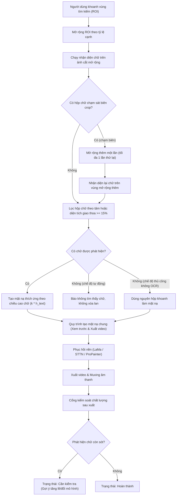

# Tài Liệu Thiết Kế: Xóa Phụ Đề Thích Ứng, Đồng Bộ Mặt Nạ Và Kiểm Soát Chất Lượng Đầu Ra

- **Mã tài liệu:** `2026-10-14-smart-subtitle-remover-adaptive-mask-and-quality-gate-design`
- **Ngày lập:** 14/10/2026
- **Trạng thái:** Bản thảo thiết kế chi tiết
- **Phạm vi:** Thẻ Xóa phụ đề video (`HomeInterface`, `VideoDisplayComponent`, `GUISubtitleRemover`, `SubtitleDetect`, `inpaint_tools`, `quality_gate`)

---

## 1. Bối Cảnh Và Mục Tiêu

### 1.1. Hiện trạng và hạn chế
1. **Lỗi đồng bộ nét cọ:** Thao tác xóa nét cọ trên giao diện chỉ xóa bề mặt hiển thị nhưng không đồng bộ danh sách rỗng vào cấu hình tác vụ. Khi bắt đầu hàng đợi, nếu danh sách nét cọ mới là rỗng, hệ thống bỏ qua việc cập nhật khiến nét cọ cũ vẫn bị áp dụng khi xuất video.
2. **Lệch pha giữa xem trước và xuất video:**
   - Hàm xem trước tạo mặt nạ trực tiếp từ toàn bộ hộp khoanh của người dùng. Trong khi đó, luồng xuất video chạy qua bộ nhận diện chữ để trích xuất hộp chữ thực tế rồi mới tạo mặt nạ.
   - Đối với các mô hình thời gian (STTN, ProPainter), hàm xem trước nhân bản 5 lần cùng một khung hình thay vì nạp các khung hình lân cận thực tế, làm sai lệch khả năng tái tạo nền chuyển động.
3. **Vùng tìm kiếm chữ bị bó cứng và cắt biên:**
   - Bộ nhận diện chữ cắt ảnh theo đúng kích thước vùng khoanh. Nếu người dùng khoanh sát chữ, các nét chữ nhô cao hoặc dấu câu tiếng Việt bị cắt đứt ở mép ảnh khiến bộ nhận diện bỏ sót chữ.
   - Bộ lọc sau nhận diện chỉ chấp nhận các hộp chữ nằm 100% bên trong vùng khoanh, loại bỏ vô lý các chữ có kích thước lớn hơn hoặc tràn nhẹ ra ngoài.
4. **Thiếu cổng kiểm soát chất lượng sau xuất trong luồng giao diện:**
   - Hệ thống mới chỉ xác minh video có thể đọc được, đủ số khung hình và giữ được âm thanh.
   - Chưa đánh giá xem chữ phụ đề đã thực sự được xóa sạch hay chưa, khiến video bị sót chữ hoặc loang nền vẫn được báo thành công hoàn toàn.

### 1.2. Mục tiêu kỹ thuật
- Tách biệt hoàn toàn vùng tìm kiếm ban đầu và mặt nạ xóa thực tế. Vùng người dùng khoanh chỉ là gợi ý tìm kiếm không gian.
- Mặt nạ xóa tự động co giãn bám sát theo kích thước và chiều cao chữ thực tế, có khoảng đệm chống răng cưa và viền bóng.
- Khắc phục triệt để 3 lỗi ưu tiên P1 về đồng bộ nét cọ, đồng bộ xem trước và cổng kiểm soát chất lượng.
- Phân biệt rõ ràng giữa hoàn tất kỹ thuật tệp tin và đạt chuẩn chất lượng hình ảnh; tự động chuyển trạng thái "Cần kiểm tra" kèm khuyến nghị khi phát hiện chữ còn sót.

---

## 2. Kiến Trúc Tổng Thể Và Nguyên Tắc Cốt Lõi



### Hai nguyên tắc vàng:
1. **Vùng khoanh dùng để định hướng tìm kiếm:** Không phải giới hạn cứng của chữ và tuyệt đối không phải là mặt nạ xóa mặc định.
2. **Mặt nạ phải bám theo chữ thực tế được phát hiện:** Nếu phát hiện chưa đủ tin cậy thì tìm lại hoặc cảnh báo, không tùy tiện mở rộng mặt nạ thành một mảng lớn che lấp nền video.

---

## 3. Thiết Kế Chi Tiết Từng Giai Đoạn

### Giai đoạn A: Nhận Diện Chữ Thích Ứng & Tách Biệt Vùng Tìm Kiếm

#### 1. Mở rộng vùng tìm kiếm (Search ROI) độc lập cho từng vùng khoanh
- Thay vì gộp chung các vùng khoanh rời rạc thành một hình chữ nhật lớn bao trùm toàn bộ khoảng trống, xử lý từng vùng khoanh riêng lẻ. Chỉ gộp các vùng khi chúng có giao thoa hoặc cách nhau dưới 15 điểm ảnh.
- Phần lề cộng thêm vào mỗi cạnh của vùng khoanh được tính toán:
  $$\begin{aligned}
  p_x &= \max(24,\ \operatorname{round}(0.35 \times W_{\text{ROI}})) \\
  p_y &= \max(16,\ \operatorname{round}(0.60 \times H_{\text{ROI}}))
  \end{aligned}$$
- Tọa độ cắt ảnh mở rộng được giới hạn an toàn trong khung hình:
  $$\begin{aligned}
  y_{\min}^{\text{crop}} &= \max(0,\ y_{\min} - p_y) \\
  y_{\max}^{\text{crop}} &= \min(H_{\text{khung}},\ y_{\max} + p_y) \\
  x_{\min}^{\text{crop}} &= \max(0,\ x_{\min} - p_x) \\
  x_{\max}^{\text{crop}} &= \min(W_{\text{khung}},\ x_{\max} + p_x)
  \end{aligned}$$

#### 2. Điều kiện chấp nhận hộp chữ linh hoạt
Thay thế điều kiện bắt buộc hộp chữ phải nằm 100% bên trong vùng khoanh ban đầu bằng điều kiện mềm:
- **Tâm hộp chữ nằm trong vùng khoanh:**
  $$(x_{\text{tâm}} \ge x_{\min}^{\text{ROI}}) \land (x_{\text{tâm}} \le x_{\max}^{\text{ROI}}) \land (y_{\text{tâm}} \ge y_{\min}^{\text{ROI}}) \land (y_{\text{tâm}} \le y_{\max}^{\text{ROI}})$$
- **Hoặc tỷ lệ diện tích giao thoa:**
  $$\frac{\operatorname{DiệnTích}(B_{\text{hộp}} \cap B_{\text{ROI}})}{\operatorname{DiệnTích}(B_{\text{hộp}})} \ge 0.15$$

#### 3. Cơ chế phát hiện chạm biên và thử lại một lần duy nhất
- Sau khi nhận diện chữ trên ảnh cắt mở rộng ban đầu, kiểm tra xem có hộp chữ nào chạm sát mép ảnh cắt hay không:
  $$\operatorname{KhoảngCáchMép} \le \max(2,\ \operatorname{round}(0.02 \times \min(W_{\text{crop}}, H_{\text{crop}})))$$
- Nếu phát hiện hộp chữ chạm sát mép ảnh cắt:
  - Hệ thống tự động mở rộng vùng tìm kiếm thêm 50% so với lề đệm trước đó ($1.5 \times p_x$, $1.5 \times p_y$).
  - Chạy nhận diện lại một lần duy nhất trên vùng mở rộng thêm này.
  - Tuyệt đối không lặp lại quá 1 lần để tránh làm chậm thời gian xử lý của cả tác vụ.

---

### Giai đoạn B: Mặt Nạ Thích Ứng Theo Chiều Cao Chữ

#### 1. Tính toán khoảng đệm theo chiều cao chữ
- Với mỗi hộp chữ phát hiện được có chiều cao $h_{\text{chữ}} = y_{\max} - y_{\min}$:
  $$p_{\text{đệm}} = \max(p_{\min},\ \min(p_{\max},\ \operatorname{round}(k \times h_{\text{chữ}})))$$
  - Hệ số mặc định: $k = 0.15$
  - Khoảng đệm tối thiểu: $p_{\min} = 3$ điểm ảnh
  - Khoảng đệm tối đa: $p_{\max} = 20$ điểm ảnh (tránh nới rộng quá mức khi phát hiện nhầm khối lớn)

#### 2. Phân biệt rõ 3 tình huống tạo mặt nạ
1. **Bộ nhận diện tìm thấy chữ:**
   - Dùng danh sách hộp chữ thực tế đã cộng khoảng đệm thích ứng $p_{\text{đệm}}$ để tạo mặt nạ.
   - Nếu chế độ mặt nạ là nét chữ (`stroke`), chạy phân tách nét chữ Canny + Otsu bên trong từng hộp chữ thực tế này.
2. **Bộ nhận diện không tìm thấy chữ (chế độ tự động):**
   - Không tạo mặt nạ cho khung hình đó và thông báo rõ ràng không phát hiện chữ; tuyệt đối không âm thầm lấy toàn bộ vùng khoanh làm mặt nạ.
3. **Người dùng chủ động chọn chế độ xóa thủ công (không dùng nhận diện chữ):**
   - Khi cấu hình `subtitleDetectMode` là `NONE`, cho phép dùng toàn bộ vùng khoanh làm mặt nạ theo đúng chủ đích của người dùng.

---

### Giai đoạn C: Khắc Phục Triệt Để Các Lỗi Đồng Bộ P1

#### 1. Đồng bộ trạng thái nét cọ khi bấm "Xóa nét cọ"
- Trong `VideoDisplayComponent`:
  - Khi gọi `clear_freehand_strokes()`, ngoài việc dọn sạch mảng `freehand_strokes` nội bộ và cập nhật hiển thị, hàm phát tín hiệu `strokes_cleared` hoặc gọi hàm đồng bộ cha.
- Trong `HomeInterface`:
  - Kết nối sự kiện nút xóa nét cọ với hàm dọn sạch:
    ```python
    cur_idx = self.task_list_component.get_current_task_index()
    if cur_idx >= 0:
        self.task_list_component.update_task_option(cur_idx, TaskOptions.FREEHAND_STROKES, [])
    ```
  - Trong `run_button_clicked()`:
    - Loại bỏ điều kiện `if cur_strokes:`; luôn cập nhật `cur_strokes` (kể cả khi là mảng rỗng `[]`) vào cấu hình tác vụ để ghi đè dứt điểm các nét cọ cũ còn lưu trong bộ nhớ tác vụ.
    - Trong luồng thực thi tác vụ: nếu tùy chọn `FREEHAND_STROKES` tồn tại trong tác vụ, luôn đồng bộ giá trị đó vào `options['strokes']`.

#### 2. Đồng bộ hóa luồng Xem Trước với luồng Xuất Video
- **Thống nhất hàm trích xuất tọa độ mặt nạ:**
  - Trong `mask_preview_button_clicked()`, thay vì chuyển thẳng vùng khoanh thành mặt nạ:
    - Kiểm tra chế độ `subtitleDetectMode`.
    - Nếu chế độ khác `NONE`, chạy `detect_subtitle()` trên khung hình xem trước hiện tại để lấy hộp chữ thực tế.
    - Nếu không tìm thấy chữ, thông báo ngay cho người dùng: *"Không phát hiện thấy chữ phụ đề trong vùng khoanh tại khung hình này. Bạn có thể điều chỉnh lại vùng chọn hoặc chuyển sang chế độ xóa thủ công."*
- **Nạp khung hình lân cận thực tế cho mô hình thời gian (STTN, ProPainter):**
  - Khi xem trước với STTN hoặc ProPainter, thay vì dùng `frames = [work_frame.copy() for _ in range(5)]`:
    - Dùng `cv2.VideoCapture` mở tệp video gốc.
    - Đọc 5 khung hình liên tiếp quanh khung hình xem trước hiện tại ($t-2, t-1, t, t+1, t+2$).
    - Xử lý biên an toàn: nếu $t < 2$ hoặc $t > N-3$, kẹp chỉ số khung hình để không bị lỗi đọc quá giới hạn.
    - Truyền chuỗi khung hình thực tế này vào mô hình, giúp người dùng nhìn thấy chính xác mức độ phục hồi nền động trước khi bấm xuất cả video.

---

### Giai đoạn D: Cổng Kiểm Soát Chất Lượng Sau Xuất Video

#### 1. Luồng đánh giá chất lượng tự động
Sau khi `GUISubtitleRemover.run()` kết thúc và kiểm tra kỹ thuật (tệp tồn tại, đọc được khung hình, đúng số lượng khung hình) đạt yêu cầu:
1. **Lấy mẫu khung hình kiểm tra:**
   - Chọn từ 5 đến 15 khung hình phân bố đều trên các đoạn phụ đề đã được xử lý.
2. **Quét lại nhận diện chữ trên khung hình đầu ra:**
   - Chạy `detect_subtitle()` trên vùng tương ứng của video đầu ra.
   - Nếu vẫn phát hiện các hộp chữ rõ ràng với độ tin cậy cao trong vùng đã xóa, ghi nhận vi phạm chữ còn sót.
3. **Đo độ nhấp nháy nền (cảnh báo nhẹ):**
   - Tính toán chỉ số biến thiên khung hình lân cận `temporal_flicker_score` trên vùng nền đã xóa.
   - Nếu vượt ngưỡng 0.08, gắn cờ cảnh báo nhấp nháy nền.
4. **Phân định trạng thái tác vụ:**
   - **Hoàn thành (Đạt chuẩn):** Không phát hiện chữ còn sót, chất lượng hình ảnh ổn định.
   - **Cần kiểm tra (Phát hiện điểm chưa tối ưu):** Phát hiện chữ còn sót hoặc nền nhấp nháy mạnh. Đổi màu trạng thái tác vụ sang màu vàng cảnh báo, hiển thị chi tiết: *"Phát hiện dấu vết chữ chưa sạch tại các khung hình đã xử lý. Khuyến nghị: tăng khoảng đệm mặt nạ hoặc chuyển đổi mô hình phục hồi nền."*

---

## 4. Kế Hoạch Kiểm Thử Chi Tiết (TDD)

Các bài kiểm thử đơn vị và tích hợp mới sẽ được thêm vào `test/test_subtitle_and_logo_remover.py`:

| Tên bài kiểm thử | Mục đích kiểm tra | Kết quả mong đợi |
| :--- | :--- | :--- |
| `test_expand_search_roi_adds_margins_and_clips_boundary` | Kiểm tra hàm mở rộng vùng tìm kiếm với tỷ lệ 35% ngang và 60% dọc. | Tọa độ mở rộng đúng tỷ lệ, không vượt ra ngoài biên 0 và kích thước khung hình. |
| `test_detect_subtitle_accepts_partially_overlapping_box` | Kiểm tra hộp chữ vượt ra ngoài vùng khoanh ban đầu nhưng có tâm bên trong hoặc giao thoa >= 15%. | Hộp chữ được chấp nhận và giữ lại trong kết quả. |
| `test_detect_subtitle_retries_when_text_touches_crop_boundary` | Kiểm tra cơ chế tự động mở rộng thêm 1 lần khi hộp chữ chạm sát mép crop. | Hệ thống mở rộng ảnh cắt thêm 1 bước và nhận diện được toàn bộ chữ. |
| `test_adaptive_mask_dilation_scales_with_text_height` | Kiểm tra kích thước mặt nạ tạo ra co giãn theo chiều cao chữ $h_{\text{chữ}}$. | Mặt nạ của chữ lớn có khoảng đệm lớn hơn chữ nhỏ, nằm trong dải an toàn $p_{\min} \dots p_{\max}$. |
| `test_clear_freehand_strokes_persists_empty_list_to_task_options` | Kiểm tra khi bấm nút xóa nét cọ trên giao diện. | Cấu hình `TaskOptions.FREEHAND_STROKES` của tác vụ đang chọn được ghi đè bằng danh sách rỗng `[]`. |
| `test_preview_uses_actual_adjacent_video_frames_for_temporal_models` | Kiểm tra hàm xem trước với mô hình STTN/ProPainter. | Chuỗi 5 khung hình nạp vào mô hình là các khung hình khác nhau quanh vị trí playback, không phải bản sao đơn thuần. |
| `test_quality_gate_flags_residual_text_after_export` | Kiểm tra luồng xác minh đầu ra khi video xuất còn chữ. | Trạng thái tác vụ chuyển thành `needs_review` hoặc cảnh báo kèm thông điệp hướng dẫn rõ ràng. |

---

## 5. Danh Sách Tệp Mã Nguồn Cần Can Thiệp

1. `src/core/tools/subtitle_detect.py`:
   - Hàm `expand_search_roi()`: mở rộng vùng tìm kiếm có lề đệm.
   - Hàm `detect_subtitle()`: mở rộng crop, lọc hộp theo tâm/giao thoa, thử lại khi chạm biên.
2. `src/core/tools/inpaint_tools.py`:
   - Hàm `create_combined_mask()` và `_build_box_uint8_mask()`: áp dụng khoảng đệm thích ứng theo chiều cao hộp chữ.
3. `src/desktop/ui/component/video_display_component.py`:
   - Bổ sung tín hiệu `strokes_cleared` hoặc phương thức xóa đồng bộ.
4. `src/desktop/ui/home_interface.py`:
   - Hàm `clear_brush_btn` clicked: cập nhật danh sách rỗng vào tác vụ hiện tại.
   - Hàm `run_button_clicked()`: luôn ghi đè `FREEHAND_STROKES` kể cả khi rỗng.
   - Hàm `mask_preview_button_clicked()`: dùng chung luồng nhận diện chữ và nạp 5 khung hình thực tế lân cận.
   - Hàm `_verify_task_output()` / kết thúc xử lý tác vụ: tích hợp quét lại chữ còn sót và phân định trạng thái "Cần kiểm tra".
5. `test/test_subtitle_and_logo_remover.py`:
   - Bổ sung 7 bài kiểm thử mới theo danh mục TDD ở trên.
