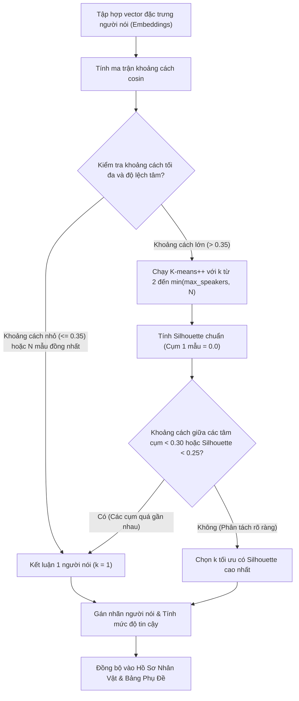

# Tài Liệu Thiết Kế: Khắc Phục Lõi Phân Cụm Người Nói Và Chuẩn Hóa Giao Diện OmniVoice

- **Mã tài liệu:** `2026-10-19-omnivoice-clustering-and-ui-alignment-design`
- **Ngày lập:** 19/10/2026
- **Trạng thái:** Bản thảo thiết kế chi tiết
- **Phạm vi:** `src/ai_engines/speaker_diarization.py`, `src/ai_engines/tts_engine.py`, `src/desktop/ui/omnivoice_interface.py`, `.github/workflows/ci-tests.yml`, `pytest.ini`

---

## 1. Bối Cảnh Và Các Vấn Đề Cần Khắc Phục

### 1.1. Lỗi nghiêm trọng tại lõi phân cụm người nói (`speaker_diarization.py`)
1. **Thiếu giả thuyết một người nói ($k = 1$):**
   - Vòng lặp phân cụm hiện tại chạy từ `range(2, max_k + 1)`, hoàn toàn bỏ qua trường hợp video chỉ có một người nói duy nhất.
   - Kết quả: Khi video chỉ có 1 nhân vật nói từ đầu đến cuối, thuật toán vẫn cưỡng ép chia thành ít nhất 2 người nói khác nhau, làm gãy vụn mạch lồng tiếng.
2. **Sai lệch cách tính hệ số Silhouette với cụm đơn lẻ:**
   - Khi một cụm chỉ có 1 mẫu, khoảng cách nội cụm $a(i)$ được gán bằng $0.0$, dẫn đến điểm Silhouette bằng $1.0$ (điểm tuyệt đối).
   - Kết quả: Các cấu hình chia nhỏ mỗi câu thành một cụm riêng biệt bị thuật toán chấm điểm cao nhất và được chọn, gây phân mảnh nhân vật.
3. **Cắt cụt số cụm ứng viên:**
   - Thuật toán giới hạn `max_k = min(max_speakers, n_samples // 2)` khi $N \ge 4$, khiến việc chọn 4 hoặc 5 người nói bị chặn không thể thử nghiệm đủ số cụm.

### 1.2. Các lỗi trong luồng giao diện và đường ống xử lý
1. **Nghe thử một câu (Preview) dùng sai chất giọng:**
   - `block_preview` truyền mẫu giọng và chỉ dẫn giọng vào luồng nền nhưng không truyền `override_mode`. Hàm `generate_single` rơi về chế độ toàn cục của giao diện, dẫn đến việc câu thoại được gán mẫu clone nhưng lại phát ra giọng thiết kế (hoặc ngược lại).
2. **Bỏ qua nhận diện tự động khi một câu đã có tên người nói:**
   - Trong `synthesize_blocks()`, điều kiện `if not any(getattr(b, "speaker", "") for b in blocks):` khiến hệ thống bỏ qua toàn bộ việc nhận diện tự động cho cả video nếu có dù chỉ 1 câu đã có nhãn người nói.
3. **Nhập nhằng chức năng của các nút nghe thử:**
   - Bảng phân vai có nút "Nghe Thử" nhưng lại phát tệp âm thanh thô gốc thay vì giọng tổng hợp.
   - Nút "Nghe Thử Toàn Bộ Nhân Vật" gọi hàm nghe một mẫu danh mục toàn cục thay vì duyệt lần lượt từng nhân vật.
4. **Mâu thuẫn trạng thái nhân vật:**
   - Khi chuyển sang "Nhân bản giọng từ video", hồ sơ tự động đổi thành "Đã khóa" dù chưa có tệp âm thanh mẫu hợp lệ.
5. **Đếm sai nhân vật và nhãn chưa phân vai:**
   - Các câu chưa có người nói bị hiển thị mặc định thành "Người nói 1". Nhãn "Chưa xác định" hoặc "Chưa phân vai" bị tính vào tổng số nhân vật nhận diện được.
6. **Thiếu hộp thoại xác nhận cảnh báo trước khi xuất:**
   - Luồng xuất chỉ chặn lỗi nghiêm trọng, bỏ qua các cảnh báo về câu chưa gán nhân vật mà không hỏi ý kiến người dùng.
7. **Lỗi đường dẫn thư viện trong quy trình kiểm thử tự động (CI):**
   - Thiếu cấu hình `PYTHONPATH: .` và `pytest.ini` khiến quy trình kiểm thử tự động trên GitHub Actions thất bại do không tìm thấy gói `src`.

---

## 2. Kiến Trúc Và Giải Pháp Thiết Kế Chi Tiết



---

### Giai đoạn 1: Sửa Lõi Phân Cụm Cosine (`speaker_diarization.py`)

#### 1. Đánh giá giả thuyết một người nói ($k = 1$)
- **Kiểm tra độ biến thiên nội tại:**
  - Chuẩn hóa L2 các vector đặc trưng.
  - Tính ma trận khoảng cách cosin: $D_{ij} = 1 - \mathbf{e}_i \cdot \mathbf{e}_j$.
  - Tính tâm cụm toàn cục $\mathbf{c}_{\text{global}} = \frac{1}{N} \sum_{i=1}^N \mathbf{e}_i$ và khoảng cách trung bình từ các mẫu tới tâm cụm.
  - Nếu khoảng cách cosin tối đa giữa hai mẫu bất kỳ $D_{\max} < 0.35$ (tương đương độ tương đồng tối thiểu $> 0.65$), toàn bộ các câu thoại đều thuộc về một người nói duy nhất ($k = 1$).

#### 2. Sửa công thức tính hệ số Silhouette và khoảng cách giữa các tâm cụm
- Với cụm chỉ có 1 mẫu ($|C| = 1$): Theo định nghĩa chuẩn toán học của Silhouette, gán $s(i) = 0.0$ (hoặc $-0.1$) thay vì gán $1.0$, loại bỏ hoàn toàn hiện tượng thiên vị cụm đơn lẻ.
- Với mỗi giá trị $k \ge 2$:
  - Sau khi hội tụ K-means++, tính khoảng cách cosin giữa các cặp tâm cụm. Nếu tồn tại hai tâm cụm có khoảng cách cosin $< 0.30$ (tương đương độ tương đồng $> 0.70$), nghiệm phân cụm này bị xem là phân chia quá đà và bị loại bỏ hoặc phạt nặng.
- Quyết định lựa chọn giữa $k = 1$ và $k \ge 2$:
  - Nếu điểm Silhouette trung bình cao nhất của các nghiệm $k \ge 2$ nhỏ hơn ngưỡng an toàn $0.25$, hoặc tất cả các nghiệm $k \ge 2$ đều có tâm cụm quá gần nhau, hệ thống tự động chọn phương án $k = 1$.

#### 3. Mở rộng dải giá trị $k$ ứng viên
- Thay thế công thức giới hạn cũ bằng:
  $$\max\_k = \max(2, \min(\text{max\_speakers}, N))$$
- Cho phép hệ thống thử nghiệm đầy đủ số cụm mà người dùng đã cấu hình mà không bị chặn cụt ở $N // 2$.

---

### Giai đoạn 2: Sửa Luồng Giao Diện Và Điều Phối Tổng Hợp

#### 1. Sửa điều kiện kích hoạt nhận diện người nói trong `synthesize_blocks()`
- Trong `src/ai_engines/tts_engine.py`:
  - Thay thế điều kiện `if not any(getattr(b, "speaker", "") for b in blocks):` bằng:
    ```python
    has_unlocked_blocks = any(
        not getattr(b, "is_speaker_locked", False)
        or not getattr(b, "speaker", "").strip()
        or getattr(b, "speaker", "") == "Chưa phân vai"
        for b in blocks
    )
    if self.multi_speaker_mode == "auto_video_cluster" and video_path and os.path.exists(video_path):
        if has_unlocked_blocks:
            self.detect_speakers_from_video(video_path, blocks, max_speakers=self.max_speakers)
    ```
  - Giữ nguyên các câu đã được người dùng khóa (`is_speaker_locked = True`), chỉ cập nhật phân vai cho các câu chưa phân vai hoặc chưa khóa.

#### 2. Đồng bộ hóa chế độ và tham số giọng khi nghe thử câu phụ đề (`block_preview`)
- Trong `_preview_selected_subtitle_row()` của `omnivoice_interface.py`:
  - Đọc hồ sơ nhân vật được gán cho dòng phụ đề:
    - Nếu phương pháp là `clone`: truyền `override_mode = "clone"`, `override_ref_audio = ref_path`, `override_instruct = ""`.
    - Nếu phương pháp là `preset`: truyền `override_mode = "design"`, `override_ref_audio = ""`, `override_instruct = voice_ins`.
  - Truyền trực tiếp `override_mode` vào `_launch_worker("block_preview", ...)` và `engine.generate_single()`, bảo đảm kết quả nghe thử một câu trùng khớp 100% với âm thanh khi xuất cả video.

#### 3. Chuẩn hóa hành vi của các nút nghe thử
- **Trên bảng phân vai:**
  - Nút tại cột thao tác được phân định rõ:
    - Nếu có tệp mẫu âm thanh: nút hiển thị "Mẫu Gốc", gọi `_play_audio_file(ref_path)`.
    - Thêm nút hoặc menu "Nghe Thử TTS": gọi hàm tổng hợp câu thoại bằng cấu hình giọng của nhân vật đó.
- **Nút "Nghe Thử Toàn Bộ Nhân Vật":**
  - Cập nhật hàm `_audition_all_speakers()`: duyệt qua danh sách các nhân vật hợp lệ đã nhận diện/gán giọng, phát lần lượt âm thanh nghe thử của từng nhân vật kèm thông báo tiến trình rõ ràng.

#### 4. Chuẩn hóa trạng thái và hiển thị bảng phụ đề
- Dòng phụ đề chưa gán nhân vật:
  - Thuộc tính `speaker` mặc định hiển thị là `"Chưa phân vai"` (thay vì tự tiện hiển thị là `"Người nói 1"`).
- Tổng quan nhân vật:
  - Loại bỏ hoàn toàn `"Chưa phân vai"` và `"Chưa xác định"` khỏi nhãn đếm tổng số nhân vật nhận diện được.
- Đổi sang nhân bản giọng:
  - Trong `_on_character_method_changed()`: nếu chưa có tệp âm thanh mẫu tồn tại, trạng thái hồ sơ phải là `"review_needed"`, tuyệt đối không gán `"locked"` làm sai lệch hiển thị.

#### 5. Cảnh báo và xác nhận trước khi xuất
- Trong `_export_subtitle_audio_track()` và `_dub_and_merge_video()`:
  - Nếu `_run_pre_export_quality_check()` phát hiện có cảnh báo (câu chưa phân vai, mẫu giọng cần rà soát):
  - Hiển thị hộp thoại xác nhận của giao diện:
    *"Phát hiện X câu phụ đề chưa phân vai hoặc cần kiểm tra lại giọng nói. Bạn có chắc chắn muốn tiếp tục xuất tệp không?"*
  - Nếu người dùng chọn "Quay lại", dừng tác vụ để người dùng chỉnh sửa. Nếu người dùng chọn "Tiếp tục", tiến hành xuất.

---

### Giai đoạn 3: Cấu Hình Kiểm Thử Tự Động (CI & Pytest)

- Tạo tệp `pytest.ini` tại thư mục gốc:
  ```ini
  [pytest]
  pythonpath = .
  testpaths = test
  ```
- Cập nhật `.github/workflows/ci-tests.yml`:
  Bổ sung `PYTHONPATH: .` vào phần biến môi trường `env:` của tác vụ chạy trên máy chủ ảo, bảo đảm các lần chạy tự động trên GitHub Actions luôn nạp đúng thư viện nội bộ `src`.

---

## 3. Kế Hoạch Kiểm Thử Chi Tiết (TDD)

| Tên bài kiểm thử | Mục đích kiểm tra | Kết quả mong đợi |
| :--- | :--- | :--- |
| `test_cosine_clustering_single_speaker_hypothesis` | Kiểm tra các vector đặc trưng của cùng một người nói (khoảng cách cosin < 0.35). | Thuật toán trả về đúng $k = 1$ cụm, không tách thành 2 người nói. |
| `test_cosine_clustering_singleton_cluster_silhouette_not_inflated` | Kiểm tra tính toán Silhouette khi có cụm đơn lẻ. | Điểm Silhouette của cụm đơn lẻ không bằng 1.0, không bị thiên vị chọn cụm phân mảnh. |
| `test_cosine_clustering_allows_full_k_candidates` | Kiểm tra với $N = 4, 5$ mẫu và `max_speakers = 4`. | Thuật toán thử nghiệm đủ $k = 2, 3, 4$, không bị cắt cụt ở $N // 2$. |
| `test_synthesize_blocks_does_not_skip_diarization_if_some_blocks_assigned` | Kiểm tra video có 1 câu đã phân vai và 9 câu chưa phân vai. | Hệ thống vẫn tự động nhận diện và phân vai cho 9 câu chưa khóa còn lại. |
| `test_block_preview_uses_correct_override_mode_and_voice` | Kiểm tra nghe thử một dòng phụ đề có phương pháp preset trong khi chế độ toàn cục là clone. | Hàm nghe thử chạy đúng chế độ design với hướng dẫn giọng của dòng phụ đề đó. |
| `test_character_overview_ignores_unassigned_labels` | Kiểm tra danh sách phụ đề có câu "Chưa phân vai". | Số đếm nhân vật nhận diện không cộng thêm "Chưa phân vai". |
| `test_clone_method_without_sample_marks_review_needed` | Kiểm tra đổi phương pháp sang clone khi chưa có tệp âm thanh. | Trạng thái hồ sơ là `review_needed`, không bị gán nhầm thành `locked`. |

---

## 4. Danh Sách Tệp Cần Chỉnh Sửa

1. `pytest.ini` (Tạo mới cấu hình nạp gói cho pytest).
2. `.github/workflows/ci-tests.yml` (Bổ sung biến môi trường `PYTHONPATH: .`).
3. `src/ai_engines/speaker_diarization.py` (Lõi phân cụm $k = 1$, tính Silhouette, kiểm tra khoảng cách tâm cụm).
4. `src/ai_engines/tts_engine.py` (Điều kiện kích hoạt nhận diện người nói trong `synthesize_blocks`).
5. `src/desktop/ui/omnivoice_interface.py` (Đồng bộ nghe thử `block_preview`, hiển thị "Chưa phân vai", trạng thái hồ sơ, cảnh báo trước khi xuất).
6. `test/test_omnivoice_pipeline.py` (Bổ sung các bài kiểm thử đơn vị và tích hợp mới).
